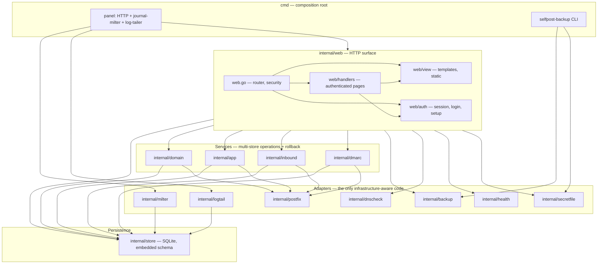

# SelfPost — architecture (as-built)

**Source of truth:** the code tree, not historical specs. Synchronise this file
when env keys, routes, or mail-path behaviour change. Verification method:
[development.md](development.md) § «Verifying docs against code».

User install/operations: [README.md](../README.md), [guide.md](guide.md). Product boundaries:
[product.md](product.md).

---

## Image and processes

Single Debian slim image. `entrypoint.sh` (root) fixes `/data` ownership and
milter socket directories, **requires** `SELFPOST_HOSTNAME` (FQDN with at least
one dot; no scheme, port, or spaces — invalid or empty value → `exit 1` before
Postfix config or supervisord), then execs `supervisord` as PID 1.

The hostname is not a tunable default: it must match PTR/rDNS, TLS CN/SAN, and
SASL realm together. Soft fallbacks (`localhost` in the panel vs container ID in
Postfix) split realms and break SMTP AUTH with a silent `535` in clients while
the panel looks healthy. Shipped `docker-compose.yml` already requires the
variable; the entrypoint gate catches `docker run`, custom compose, and k8s.

Managed programs ([build/supervisord.conf](../build/supervisord.conf)):

| Program | User | Priority | Role |
|---|---|---|---|
| `syslog-relay` | panel | 50 | The container's `/dev/log`: passes what OpenDKIM logs through syslog(3) to the container's log (`panel -syslog-relay`) |
| `opendkim` | root → `opendkim` (`UserID` in opendkim.conf) | 100 | DKIM signing milter |
| `panel` | panel | 200 | HTTP UI + sender check + journal-milter + log-tailer + rate-limit recalc; with the inbound relay on also the inbound journal milter |
| `postfix` | root (wrapper) | 300 | MTA — started only after the milter sockets exist (OpenDKIM's, the sender check's, the journal milter's and, with the inbound relay on, the inbound journal milter's) |
| `postfix-reload` | root | — | On-demand `postfix reload` (autostart off) |
| `cert-reload` | root | 400 | Daily: re-copies a renewed TLS certificate for Postfix and reloads it |
| `logrotate` | root | 400 | Periodic `mail.log` rotation |

Start order: syslog-relay → OpenDKIM → panel (opens the sender check's and the journal-milter's sockets) → Postfix wrapper
polls unix sockets (timeout `MILTER_WAIT_TIMEOUT`, default 30s) then runs
`postfix start-fg` and stays its parent: on TERM it runs `postfix stop`, so a
stop of the program or of the container stops Postfix as Postfix means it to
be stopped (master runs in a session of its own, which supervisord's signal
never reaches). Program `postfix` has `startsecs` = `MILTER_WAIT_TIMEOUT` + 10
(set by the entrypoint), so the wrapper giving up on the sockets, or a Postfix
that will not start, is an exit supervisord counts as too quick: once
`startretries` (3) are spent, the program is FATAL. For those seconds after
each start it is STARTING.

`crashexit` event listener exits the container when a program of the mail path
is FATAL - it crashed before its `startsecs` four times running (the start
and `startretries=3`) - or has
exited unexpectedly five times in ten minutes, however long each run lasted
(an exit after `startsecs` is EXITED and restarted, never FATAL; `2.6.0`), so
Docker `restart: unless-stopped` starts it again - the same container, not a
new one: the entrypoint clears what the last run left in `/run` (the milter
sockets, the sender check's alive mark). Besides a stop, supervisord itself
dying, or the entrypoint refusing a setting, nothing else exits the
container. `logrotate`'s FATAL (a config logrotate would ignore),
`postfix-reload`'s (reported to the page that asked), `cert-reload`'s and
`syslog-relay`'s stay on Server › Health instead.
The panel runs `postfix-reload` through supervisord's XML-RPC interface and
waits for its exit status (`internal/supervisor`, `RunOnce`); the program
rests EXITED after a run.

**Liveness:** `GET /healthz` (unauthenticated) returns 200 when opendkim,
panel, and postfix are RUNNING; Docker `HEALTHCHECK` uses the same probe (its
90-second start period covers postfix's STARTING).

---

## Mail path

```
Client ──TLS+SASL──► Postfix (465 smtps, optional 587 submission)
                         │
                         ├─► sender check (From: against the login, tempfail on failure)
                         ├─► OpenDKIM milter (sign, tempfail on failure)
                         ├─► journal-milter (send log + L2 rate limits, fail-open)
                         └─► outbound MX delivery (port 25 client)

Internet ──► Postfix smtp inet :25  (when INBOUND_RELAY_ENABLE=true
                         │           and/or DMARC_REPORTS_ENABLE=true)
                         │
                         ├─► optional antispam milter (inbound relay only)
                         ├─► DMARC aggregate ingest (pipe → dmarc-ingest)
                         └─► smtp:[upstream]:port  (inbound relay only;
                             transport_maps; no local delivery)
```

The smtp/inet listener is **absent** when both flags are off (`postconf -MX
smtp/inet` removes Debian's stock smtpd). Outbound delivery still uses the
`smtp unix` client; it is not the same service.

### Postfix ([build/postfix-config.sh](../build/postfix-config.sh))

- **465/smtps** — implicit TLS, SASL required; primary listener.
- **587/submission** — only when `SUBMISSION_ENABLE=true`; STARTTLS with
  `smtpd_tls_security_level=encrypt`.
- **25/smtp inet** — when `INBOUND_RELAY_ENABLE=true` and/or
  `DMARC_REPORTS_ENABLE=true`. No SASL, no OpenDKIM, no journal-milter —
  `smtpd_milters` is always overridden on this service, because main.cf's
  submission chain would otherwise let a signing outage defer relayed mail and
  would file inbound mail into the outbound send log under the sender's
  domain. With the inbound relay on the chain is the optional antispam milter,
  then the panel's **inbound journal milter** (unix socket
  `INBOUND_JOURNAL_MILTER_SOCKET`, default
  `/run/selfpost/inbound-journal.sock`, `default_action=accept`); with DMARC
  ingest alone it is empty. Postfix hands a message to its milters one after
  another at end-of-message, each seeing what the one before added, so the
  journal milter sees only mail the filter let through and reads the filter's
  verdict headers (`X-Rspamd-Action`, `X-Spamd-Result`) off it. It writes one
  `inbound_spam_log` row per recipient at an inbound domain - a DMARC report
  address is not one - and never refuses anything
  ([internal/milter/inbound.go](../internal/milter/inbound.go)). The headers
  are read only while a filter is attached, and only next to the filter's
  signature: a third header, `X-SelfPost-Filter`, the HMAC-SHA256 of the
  message's queue id under the key in `/data/antispam/filter.key`
  (`inbound.FilterKey` makes it on first start; rspamd reads it through the
  mounted directory and signs in a custom routine of `milter_headers.conf`).
  rspamd removes a sender's own copies of the three headers and writes and
  signs its own for every message it lets through: `skip_local` and
  `skip_authenticated` are off in that file, so this holds whatever the
  sender's address (rspamd 3.11.1, `src/plugins/lua/milter_headers.lua`,
  `skip_wanted()`).
  With the filter down - it is attached fail-open - a sender's own verdict
  headers carry no signature and the row is that of mail nobody judged.
  Refused mail never reaches this milter.
  Refusals come from `mail.log`: this listener logs as `postfix/inbound`
  (`syslog_name`), and the log tailer turns a `reject:` line of
  `postfix/inbound/smtpd` (Postfix's own policy) and a `milter-reject` /
  `milter-hold` / `milter-discard` line of `cleanup` (the filter's verdict,
  counted only for a queue id that listener opened) into a row, dated by the
  line, when the recipient is at an inbound domain
  ([internal/logtail/inbound.go](../internal/logtail/inbound.go)). A line
  names one recipient (the last), so a message refused at end-of-message is
  one row whatever its recipient count. The tailer saves its place every five seconds,
  so after an unclean stop it reads some lines again; the lines it reads on
  start are written only if the same row is not there already. The
  journal is pruned every six hours: rows
  older than the `inbound_spam_log_retention_days` setting, then down to
  10 000.
  **Filter lists** (`inbound_spam_list`): allow and deny entries for the
  external filter - sender address, sender domain, client address or network -
  validated and normalised by `internal/inbound` (`lists.go`) and written as
  six map files under `/data/antispam/` (`ANTISPAM_DIR`), each atomically, on
  every change and on every start with the relay on. SelfPost never consults
  them. The sidecar mounts the directory and rspamd's multimap rules
  ([deploy/antispam/rspamd/multimap.conf](../deploy/antispam/rspamd/multimap.conf))
  read them: a deny entry's rule carries the action `reject`, which rspamd
  sets as a pre-result (a passthrough result: the remaining filters are not
  run and the action stands whatever the score), an allow entry is a symbol
  weighing -100. Allow is
  deliberately not an `accept` action: with two pre-results rspamd keeps the
  one set first, and deny then won or lost by rule order (seen on rspamd
  3.11, date not recorded). A refusal by the deny list overrides any score,
  so deny wins whichever entries match - measured in a throwaway
  `rspamd/rspamd:3.11.1-3` with this file, 2026-10-15: the same address or
  IP on both lists, an allowed address with a denied domain or IP, and an
  allowed IP with a denied address were all `reject` (assumptions
  D-arch:121). A sender entry is matched against
  the envelope sender only (`extract_from = "smtp"`; by default rspamd takes
  a bounce's `From:` header instead - rspamd 3.11.1,
  `src/plugins/lua/multimap.lua`, the `from` callback).
  How often an entry decided a message is not stored: `Lists.Usage` reads it
  off the journal on each view of Filter lists - the rows a list decided (the
  deny rule's reply, the allow rule's symbol, which the journal milter keeps
  ahead of its six-symbol cap) matched against the entries as rspamd matches
  them. When that stops being good enough is written in
  [plans/inbound-antispam-panel.md](plans/inbound-antispam-panel.md) § Filter
  list usage.
  **Inbound relay** (`INBOUND_RELAY_ENABLE=true`): accepts only
  `relay_domains` + `relay_recipient_maps` (`reject_unauth_destination`,
  `reject_unlisted_recipient`). Maps under `/data/postfix/` (`relay_domains`,
  `transport`, `relay_recipients`, `tls_policy`), written atomically by
  [internal/postfix/inbound.go](../internal/postfix/inbound.go). Domains with
  an empty upstream host are omitted from the maps. Optional
  `INBOUND_ANTISPAM_MILTER` only when inbound relay is enabled (not on
  DMARC-only port 25); it is attached with its own `default_action`,
  `INBOUND_ANTISPAM_MILTER_ACTION`, which is `accept` (fail-open) unless set
  to `tempfail` (main.cf's `milter_default_action` is `tempfail`).
  **DMARC ingest** (`DMARC_REPORTS_ENABLE=true`): allow-listed
  report addresses via `check_recipient_access` on `postfix/dmarc_recipients`;
  messages pipe to `dmarc-ingest` (symlink to `panel`). When both flags are
  on, one listener serves both paths; per-IP rate uses
  `INBOUND_RATE_LIMIT_MESSAGES_PER_IP` and message size uses the greater of
  `INBOUND_MESSAGE_SIZE_LIMIT` and `DMARC_MESSAGE_SIZE_LIMIT`.
- **No open relay** — `permit_sasl_authenticated`, `reject_unauth_destination`;
  `smtpd_sender_login_maps` + `reject_sender_login_mismatch`. That holds the
  envelope sender; the `From:` header is held to the same table by the
  panel's sender check (§ Panel roles).
- **Level-1 rate limit** — `smtpd_client_message_rate_limit` /
  `anvil_rate_time_unit` from `RATE_LIMIT_*` env vars; independent of milter.
- **Port 25 ends DATA only at `<CR><LF>.<CR><LF>`** —
  `smtpd_forbid_bare_newline=normalize` on the `smtp/inet` listener (Postfix
  3.7.11, `src/smtpd/smtpd.c`, the DATA loop at 3649: a `.` line next to a
  bare `<LF>` is dropped, not taken as the end); a bare `<LF>` elsewhere is
  read as `<CR><LF>`. The submission ports keep Postfix's default.
- **Chroot disabled** for all services (DNS/TLS inside container).
- **TLS certs** — read-only mount at `TLS_CERT_FILE` / `TLS_KEY_FILE`, copied
  at start into `/etc/postfix/tls-internal`, owned by root and `0600` as
  Postfix's TLS_README advises (Postfix itself reads the key as root and does
  not check its mode), which the mount cannot give; Postfix reads the copy.
  `cert-reload` compares the mount with the copy daily; when they differ and
  the certificate and key belong together it renews the copy (each file
  renamed into place) and reloads Postfix.

### OpenDKIM

Per-domain keys under `/data/opendkim/keys`; `KeyTable` / `SigningTable` maintained
by the panel. Socket `/run/opendkim/opendkim.sock`.

The server's own name (`SELFPOST_HOSTNAME`) has a key and a line in both
tables too, without being a row of the registry
(`domain.Service.SetServerName`): the panel's notifications are sent as
`postmaster@` that name and signed with it. No application can use it as an
envelope sender - the sender map is built from the registry - and since
`2.4.0` none can have a message signed as the server by writing it into
`From:` either: the sender check holds the header against the login (§ Sender
check). A sending domain of the same name shares its key and selector with
the server; deleting that domain leaves the server signed under the default
selector, which is the same key only if that was the domain's. At its start
the notifier makes sure the tables have the line and name the selector the
panel shows (`EnsureServerSigned`): tables are otherwise rebuilt only when a
domain is added or deleted.

### Panel binary ([cmd/panel](../cmd/panel))

One process, six roles (seven with the inbound relay on: its inbound journal
milter, § Postfix above, port 25):

1. **HTTP server** — `:8080` (`PANEL_HTTP_ADDR`); HTTPS terminated by reverse
   proxy only. On start it runs `postconf -h -x` once for the deferred-mail retry
   parameters (`queue_run_delay`, `minimal_backoff_time`,
   `maximal_backoff_time`, `maximal_queue_lifetime`, `bounce_queue_lifetime`,
   `delay_warning_time`), reads each as Postfix does - one number and one
   unit, the parameter's own default unit when there is none (`5d` for the
   lifetimes, so a bare `3` is three days), `bounce_queue_lifetime` capped at
   `maximal_queue_lifetime` as qmgr caps it (Postfix 3.7.11,
   `src/global/conv_time.c`, `src/qmgr/qmgr.c`) - and caches the snapshot on
   the handlers config. The
   Outbound queue box and a delivery's `deferred` / `bounced` history print those
   numbers; they never call `postconf` per request. If `postconf` is missing,
   the panel logs a warning and uses Postfix 3.x compiled-in defaults
   (`300s` / `4000s` / `5d` / `0`) with a muted note on the box.
2. **sender check** — unix socket `SENDER_CHECK_SOCKET`, first in the chain
   and **strict** (`default_action=tempfail`): § Sender check below.
3. **journal-milter** — unix socket `JOURNAL_MILTER_SOCKET`; records From/To/
   Subject/SASL user at DATA; enforces level-2 rate limits; **fail-open**
   (`default_action=accept`) so milter failure does not stop mail. Domain
   ceilings apply to every client IP; an application ceiling **overrides** the
   domain one for that login, higher or lower (guide § Rate limiting). Since
   1.9.0 the client IP allow-list is a separate, restrictive control on the
   application (`applications.auth_ip_restrict`), checked here at `MAIL FROM`
   and fail-open like the rest of this milter — not an authentication
   boundary. The level-2 count is the stored send-log rows plus the messages
   this process has admitted but not yet written (`internal/milter/inflight.go`),
   so concurrent sessions cannot each spend the same last slot; a reservation
   is released at end-of-message, on ABORT, or after a 10-minute TTL.
4. **log-tailer** — follows `MAIL_LOG`, updates send-log delivery status by
   queue-id. Send-log `queued → sent` transitions depend on this goroutine alone
   (`UpdateStatus` is only called from [internal/logtail](../internal/logtail/logtail.go)).
   It also keeps the lines Postfix writes under a queue id, for the message's
   page (§ Log tailer, *Stored lines*), and counts the mail Postfix deferred
   because the sender check did not answer.
5. **rate-limit recalc** — every six hours (and on demand from Domain settings and
   the application form), recomputes level-2 **Auto** rate limits from send-log statistics.
6. **notifier** — writes to the panel's users when something needs them
   (§ Notifications below).

Milter chain in Postfix: the sender check (tempfail), OpenDKIM (tempfail),
then the journal (accept on failure). Mail submitted locally with
`sendmail(1)` — the notifier's — passes OpenDKIM alone (`non_smtpd_milters`):
it is signed, it is the panel's own and so needs no check of whose it is, and
it is not an application's mail to be journalled or limited. Bounces Postfix
generates pass no milter.

### Sender check

[internal/milter/sender.go](../internal/milter/sender.go) holds a message's
`From:` header against the application that sends it
([plans/from-header-binding.md](plans/from-header-binding.md)). Postfix holds
the envelope sender against the SASL login, and OpenDKIM chooses the signing
key by the header; until `2.4.0` nothing connected the two, and an
application could have mail signed as another domain of the server or as the
server itself.

- **The rule is the envelope's.** The check reads the file Postfix reads for
  `smtpd_sender_login_maps` and makes the same lookup: the address itself is
  bound to the login, or `@domain` is. So an application set to any address of
  its domain may write any address of that domain, and one with a list only
  the listed ones; everything else is refused - another registered domain,
  the server's name, a domain the server knows nothing of. One table for
  both senders, read as Postfix reads a texthash table and looked up as
  Postfix looks it up: the address, the address without its `+extension`
  (`recipient_delimiter`, which `build/postfix-config.sh` sets for that
  reason), then `@domain` - and the **first of these keys in the table
  decides**, its owners alone: an address listed for one application is not
  open to another that holds the whole domain. Logins are compared without
  regard to case, as Postfix compares them (Postfix 3.7.11,
  `src/smtpd/smtpd_check.c`, `reject_auth_sender_login_mismatch()`, over
  `src/global/mail_addr_find.c`, `mail_addr_find_opt()`). A key written
  twice makes Postfix refuse the whole table, and the check defers then too.
- **How the header is read.** Exactly one `From:` field (none, or more than
  one, is refused), read with OpenDKIM's own parser: libopendkim's
  `dkim_mail_parse()`, ported line for line from Debian's opendkim
  2.11.0~beta2 (`internal/milter/mailparse.go`) and tested against the C on
  two hundred thousand lines. The check asks Postfix for header values with
  their leading space, as OpenDKIM does (`SMFIP_HDR_LEADSPC`), so both read the
  same bytes. The address it returns is the one judged - the one OpenDKIM
  signs for - whatever a display name, a comment or a quoted local part
  holds; a parse failure, no address, or a second one after it is refused,
  and so is an address over 256 bytes, which OpenDKIM would match its
  `SigningTable` against cut short (`dkimf_apply_signtable()`,
  `MAXADDRESS`). Encoded words are not decoded, by either. The line must also
  be one address in RFC 5322's grammar (`net/mail`), at the domain OpenDKIM
  signs for, so that a mail program shows the address that is signed; that
  address, its local part unquoted, is what the bindings are asked about.
- **The verdict** comes at the end of the headers: `550 5.7.1`, permanent,
  naming the line, as a reply code of the milter's own. What the client wrote
  is reduced to printable ASCII and cut before it is said back, logged or
  stored. A message with no SASL login is refused as well; the submission
  ports do not let one this far.
- **Strict, and therefore small.** Postfix attaches the socket with
  `default_action=tempfail`: while the panel does not answer on it within the
  milter timeouts, mail is deferred, not accepted unchecked. The role
  therefore reads no database. Its two inputs are files the panel rewrites by
  rename and the mail path itself goes by; they are read again when their
  time or size has changed, and a file that cannot be read defers mail - a
  table from before would let a deleted application go on sending. The
  send-log row of a refusal (`status=rejected`, `reason=from`,
  `header_from`) is handed to another goroutine through a buffer and is not
  waited for. It is one row for the message, naming the first recipient and
  how many more there were: a row per recipient would let one refused message
  write a thousand.
- **What it costs is counted.** The role marks itself alive every two
  seconds (the socket's path with `.alive`, under `/run`; the entrypoint
  removes it at every container start, so a restart begins without one). At
  start the time since the mark is the check's
  downtime - counted from Postfix's own start if that was later, and not at
  all when supervisord says Postfix is not running, since mail was then
  stopped for another reason. Supervisord is asked for half a minute; when it
  does not answer, the time since the mark is taken as an upper bound and the
  day is marked estimated (`sender_check_days.estimated`), which the card
  shows as ≈. The log tailer counts the mail: Postfix
  writes a warning naming the socket and then, from the same smtpd process,
  `milter-reject: … 451 4.7.1 Service unavailable` from the connection on
  (the client is told `454 4.3.0` at `AUTH` and leaves), so what is counted
  is a connection turned away, once - how many messages it held back is not
  known: a client may bring one or several, or come back for the same one.
  The reject line does not name the milter and the journal milter's
  level-2 refusal reads the same, hence the warning. A panel that is running
  and stops answering in the middle of a message (its socket accepts, nothing
  replies) is met by cleanup, not smtpd: past `DATA` it is cleanup that talks
  to the milters, and after the content timeout it writes `warning: milter
  unix:<socket>: can't read SMFIC_HEADER reply packet header` and refuses the
  message with `4.7.1` (seen on the e2e stand with the panel frozen;
  `panel_hung_mid_message_is_counted` checks it at every run). One
  cleanup process serves message after message, so each such warning is
  counted as a message. The two are counted apart (the owner, 2026-10-14):
  connections turned away in `deferred`, messages deferred mid-message in
  `messages` of `sender_check_days`, a row per UTC day kept a year, and
  Server › Health shows today, 30 days and 12 months in a column each. The
  counts also see a panel that is running and not answering, which the mark
  does not. Downtime is cut at the UTC midnights it crossed. A log read again
  after an unclean stop does not count again: the count and the place in the
  log it reached (the file's fingerprint and the offset past the line) are
  saved in one transaction, and while the tailer catches up a warning at or
  before that place in the same file is passed over - a second warning of
  the same second is not lost; in another file the time decides.
- **Why it is not a process of its own.** Decided with the owner: measure
  first. The role has a socket of its own so that the journal stays
  fail-open, and moving it out later changes where it is started and nothing
  else.

### Notifications

[internal/notify](../internal/notify/notify.go) reports four things to the
users of the panel: a sending domain's DNS record that stopped matching, a
level-2 rate limit that refused mail, the TLS certificate about to expire, a
message more than three days in the queue. The rules of when a message goes
out are the owner's and are written in
[plans/panel-notifications.md](plans/panel-notifications.md) § When a message
is sent; the operator's view is guide § Notifications.

- **Readings.** Once an hour, starting three minutes after the process does:
  every sending domain's records through a DNS checker of the notifier's own,
  forced past the cache (`cmd/panel/notifier.go` builds the same query a
  domain's page does); the certificate file; `postqueue -j` for the arrival
  time of each queued message. Once a minute: the send log's `rejected` rows
  of the last day, through a partial index of their own.
- **A refused row is not believed whole.** Its domain is the one in
  `MAIL FROM`, which the client typed and Postfix has not yet held against
  the login when the milter refuses; the same status is written when an
  application is refused for its client address or its `From:` line. Since
  `2.4.0` a row says which (`send_log.reason`) and only a limit's rows are
  taken; a row from before has no reason. So refusals are counted by
  the domain the login is registered under, only for logins that exist, and
  only while a level-2 limit is set on the login or its domain
  (`Store.LimitRefusalsSince`). One subject per sending domain, whichever of
  its applications are refused.
- **State** is a row per subject in `notify_state` (`dns:<domain>`, `cert`,
  `queue`, `limit:<domain>`), which is what makes each thing be said
  once and a restart say nothing again. A DNS subject goes *pending* on the
  first bad check and *open*, with a message, on a later one at least 45
  minutes after it - a count alone would let the last check before a restart
  and the first after it stand for "an hour apart"; back the same way. The
  certificate's row remembers which threshold was said for which expiry. A
  deleted domain's `dns:` row goes at the next check; its `limit:` row stays
  until it was last said more than 48 hours ago (`CheckLimits`).
- **Said means sent.** A problem that arises while no user can be told, or
  while Postfix does not take the message, stays unsaid and is told at a
  later check. Its ending, with nobody left to tell, is simply over.
- **Owed to each recipient** (since `2.5.4`, `notify_addressees`): the
  subject's first message records who it was addressed to and who was
  handed a copy; while the subject is open, every later check hands it to
  those not told yet - a copy that failed, or that the ceiling held back -
  who are still recipients. A user who comes to hear of a subject only while
  it is open is not mailed about it, and its ending goes to those who were
  told. A subject opened before `2.5.4` has no such record, and its ending
  goes to every recipient, as it did. It is owed to an address: a user who
  changes their e-mail while a subject is open is a new address, told
  neither its follow-up nor its end - accepted, a subject lasts hours to
  days.
- **The notifier's own mail is not a subject.** A notification waiting for a
  mailbox that does not answer, or its bounce coming back to
  `postmaster@<hostname>` - which receives no mail - is left out of the
  queue check.
- **A ceiling** of 60 messages an hour stands over all of it.
- **No information is not a finding.** A lookup that did not answer, a queue
  that cannot be listed, a certificate that cannot be read move no state.
- **Recipients** come from the store at the moment of sending: global users
  for everything, domain users for subjects that are a domain's; only users
  with an e-mail and their own switch on. One message per recipient, so users
  do not see each other's addresses.
- **The instance switch** (settings key `notifications`, on unless turned
  off) stops the checks themselves, not only the mail: no state moves while
  it is off.
- **Sending** is `sendmail -i -f postmaster@<hostname> -- <address>` as the
  unprivileged panel user, which is a member of `postdrop` and so can write
  the maildrop directory without the setgid bit `no-new-privileges` forbids.
  A message that could not be handed over leaves the state where it was and
  is tried at the next check. The text names the page to open and has no
  link: the panel does not know its own address.

### Log tailer and `mail.log` rotation

`mail.log` lives at `/data/log/mail.log` — inside the persistent bind mount, so
the delivery lines that resolve a `queued` send-log row are not lost when the
container is recreated. `postlogd` writes it as user `postfix`; the panel reads
it through the shared `selfpost` group (directory `2750 postfix:selfpost`, file
`0640`, both normalised on every start by
[build/entrypoint.sh](../build/entrypoint.sh)). The path is one default in two
places, `maillog_file` in [build/postfix-config.sh](../build/postfix-config.sh)
and `MAIL_LOG` in [cmd/panel/main.go](../cmd/panel/main.go). Backups exclude
`log/`: it is diagnostic output, not state to restore.

Rotation uses rename + `postfix reload`
([build/logrotate-mail.conf](../build/logrotate-mail.conf)), not `copytruncate` —
the latter can drop `status=sent` lines and leave send-log rows stuck at
`queued`. After rename, logrotate runs `create 0640 postfix selfpost` (postlogd
recreates the file on its first line after the reload, as root and mode
`0600`, which the unprivileged panel user cannot read). `follow()` drains the
old inode once more before switching descriptors, and keeps it open and reads
it for a minute after: postlogd keeps writing to the renamed file until the
reload makes it exit, seconds later (Postfix 3.7.11, src/postlogd/postlogd.c;
src/master/dgram_server.c, `dgram_server_abort()`). The panel treats a missing
log file as an empty tail, not an error.

**Delivery lines are read at the head of the line.** The pattern that turns a
line into a row's status (`deliveryRe`) is matched after the timestamp, the
host name and `program[pid]:`, at the queue id - like the stored lines' and the
inbound journal's. The tail of a line is the far end's words (a reply, a HELO
name), and a pattern that could start there let a stranger's HELO name file a
delivery (audit 2026-10-12, M12).

**Read offset is persisted** (`logtail_state` table, in the baseline schema): the
tailer stores its position plus a fingerprint of the log - the hash of its first
512 bytes and the file's device and inode, so two logs that begin alike are two
files and a renamed file keeps its fingerprint - and on start resumes from it,
parsing the tail written while the panel was down. If the fingerprint no longer
matches, the log was rotated in the meantime: the tailer first opens
`mail.log.1` (left plain by `delaycompress`), and if that is the file the saved
place belongs to it reads it from there to its end, then the new file from its
start - what Postfix wrote between the stop and the rotation is not lost. A
`mail.log.1` that is another file (rotated twice) is logged with the time from
which nothing was read. Re-parsing lines is harmless because `UpdateStatus`
writes the same status onto the same row. Only a first-ever start, with nothing
stored, begins at end-of-file, so installing the panel does not replay a
pre-existing log.

**A refusal's line, and a refusal the panel did not write.** A message refused
for its `From:` line has a queue id (cleanup gives one before the headers are
judged); the sender check writes it on the row, and the message's page shows
the lines stored under it - only those of the minutes around the refusal, since
Postfix frees the id at once. A message the journal milter refused at
`MAIL FROM` has none: the tailer reads smtpd's `NOQUEUE: milter-reject: MAIL
from <client>[<address>]: …; from=<…> … sasl_username=<login>` - the login is
Postfix's last field on an authenticated session (Postfix 3.7.11,
`src/smtpd/smtpd.c`, `smtpd_whatsup()`), and a line without one is no
application's - and puts it on the nearest refused row of that client
address, login and sender within two minutes
(`send_log.refusal_line`; the milter writes `send_log.client_ip`), retrying
for 30 s when the row is not written yet; a line already on a row goes on no
other. The sender check writes its
row through a buffer after answering 550; a panel stopped in between wrote
none. The tailer remembers each queue id's login from smtpd's `client=` line,
and 30 s after cleanup's `milter-reject: END-OF-MESSAGE … 5.7.1 From:` line it
writes the row from the line if no refused row of that id exists
(`send_log.recovered`, shown on the page). cleanup's line names one
recipient, the message's last (`src/cleanup/cleanup_milter.c`), so a row
written from it has that one, which its page says. It reads from its saved offset, so
a kill is covered as well as a clean stop.

**Expiry.** A message Postfix gives up on at the end of its queue lifetime has
no line per recipient: qmgr writes one line for the message, `<id>:
from=<...>, status=expired, returned to sender` (`force-expired` after
`postsuper -e`; Postfix 3.7.11, `src/qmgr/qmgr_active.c`,
`qmgr_active_done_25_generic()`), and the recipients' last lines say
`deferred`. The tailer reads that line and closes the message's open rows -
each recipient's newest, `queued` or `deferred` - as `bounced`.

**Queue reconcile** is the backstop for what the log cannot explain at all: a
row still open - `queued`, or `deferred` and waiting - more than two minutes
after it was accepted, whose queue id `postqueue -p` no longer lists, is
marked `bounced` with the reason `reconcile` (swept every five minutes,
[internal/logtail](../internal/logtail/logtail.go),
[postfix.QueueIDs](../internal/postfix/queue.go)). Postfix having dropped the
message means nothing more will ever be reported about it, so the row can only
be closed on an assumption, and it is closed as a failure because a delivery the
panel cannot evidence must not be shown as one. What keeps the sweep from
guessing where it need not: it starts only after the tailer has read to
end-of-file once (on a restart the log itself holds the answer); the two-minute
grace covers messages merely in flight; a `postqueue` that cannot be read, or
whose listing is over the 4 MiB cap, leaves every row untouched rather than
closing them all or those past the cut; and the close, by the row's id, is
conditional on the row still being open, so a final status the log wrote in
the meantime stands. A deferred row is the sweep's too because Postfix can
drop a deferred message without a final line for its recipients: at expiry
before `2.5.2` read that line, and with `postsuper -d`, which logs only
`removed`. The listing's `#` - a message forced to expire - is read as part
of the id's flags (`src/postqueue/showq_compat.c`, `showq_message()`).

**Which row a delivery line is.** The journal milter writes a row's
recipient as Postfix will log it: the address the client gave, its quoted
local part unquoted and quoted again only where it needs to be (`"ab"@x`
becomes `ab@x`, `"a b"@x` stays; Postfix 3.7.11, `tok822_parse.c`,
`quote_822_local.c`), case kept, and a recipient given twice - in any case -
once, since cleanup keeps one (`cleanup_out_recipient.c`, `been_here()`
folding case). A delivery line names it in `orig_to=` when Postfix rewrote
the address, in `to=` otherwise (`log_adhoc.c` writes `orig_to=` only then),
and is matched without regard to case. It updates only the newest row of its
queue id and recipient: Postfix reuses a short queue id once the message has
left the queue, and an old row must not be rewritten. `UpdateStatus`'s transaction
starts with a write, so a commit by the `dmarc-ingest` process in between
cannot fail it with `database is locked`.
Now that the log survives the container, reaching this path should mean the
lines are gone for good — rotated past fourteen files while the panel was down,
or deleted — or that the tailer was not reading.

Whether the sweep earns its place is measured, not argued (audit 2026-10-12,
H3). `delivery_log_days` (migration `0007`) keeps, per UTC day for a year:
`reconcile_closed`, the rows the sweep closed; `reconcile_missed`, those of
them whose final line - sent, bounced, or the message's expiry - was in
`mail.log` or `mail.log.1` when the sweep closed them - the tailer did not
read a line that was there, which is what a lost line looks like (it is never
read late; a deferred line is not one, a deferred row has it by definition); `reconcile_contradicted`, those
a delivery line read later gave a status - the log's status replaces the
sweep's and the row's reason becomes `reconcile-contradicted`, so a row counts
once and can be found; `tailer_blind_seconds`, the time `follow()` could not
read `mail.log` (the file gone, reopening it failing; stretches under three
seconds - a rotation's tick between rename and create, which loses nothing -
are not counted); and `queued_over_lifetime`, the rows still open (`queued`
or `deferred`; `queued` only before `2.5.2`) past the queue lifetime plus a
maximal backoff, as the day's last sweep saw them - rows
stuck although the sweep runs (mail on hold, or a queue that could not be
listed). What removing the sweep would leave queued is closed − missed −
contradicted: the rows nothing in the log ever resolved. No page shows the
table: it is read off a copy of the database. The rule, written before the
data: `reconcile_closed = 0` for a month → remove the sweep; closed, but
neither missed nor contradicted → keep it; missed or contradicted → the tailer
loses or delays lines - fix the tailer (the two deferred steps: the rotation
window, pausing the sweep while blind) and keep the sweep; if what remains
after that is never resolved by the log, mark such rows `lost` or remove the
sweep. Decided after thirty days, or sooner if `reconcile_missed` or
`reconcile_contradicted` is ever non-zero.

**Stored lines** (`send_log_lines`, since 2.2.0;
[internal/logtail/lines.go](../internal/logtail/lines.go)). A send-log row
lives for the retention window, ninety days by default, and `mail.log` for a
day before it is rotated; a message's page (`/outbound/log/{id}`) shows what
Postfix wrote about it, so the tailer keeps those lines in the database as it
reads them:

- **What is kept:** a line headed by a queue id — after the timestamp, the
  host name and `program[pid]:` — with that id, the line's own time and the
  line as written, cut to 4096 bytes. The id is read from the head of the line
  only: the tail is the far end's text. `NOQUEUE` and `warning` stand in the
  same place and are not ids; the pattern accepts Postfix's short form
  (capital hexadecimal) and its long form (no vowels).
- **Port-25 mail is left out.** A queue id opened by `postfix/inbound/smtpd`
  is a stranger's message and never gets a send-log row; none of its lines
  are stored, up to qmgr's `removed` or until another listener opens a
  message under the id (4096 such ids are remembered). What a stranger can
  make Postfix log is therefore not written to the database at his rate.
- **No check for a row at write time.** A message's first lines (`client=`,
  `message-id=`) are logged before the journal milter writes its row at
  end-of-message, so the tailer cannot ask whether the id is in the send log.
  Lines that never get a row — bounces Postfix generates, port-25 mail met in
  mid-flight after a restart — are kept for a while.
- **Written per pass, not per line:** the lines of one pass over the log go
  in one transaction (`InsertSendLogLines`), 500 at most, before the read
  offset is saved. A commit per line would be a disk sync per line on the
  connection the journal milter shares.
- **Retention is one rule:** a line older than an hour whose queue id no
  send-log row carries is deleted (`PruneSendLogLines`), at start and after
  every six-hourly send-log sweep. That removes the lines of rows the sweep
  deleted and the lines that never had a row. The send log is asked once per
  queue id; the statement still walks the table, with the connection taken
  meanwhile. Measured on the test server (2 cores, 2026-10-15) with 1.37
  million lines, 120 days at 1 900 messages a day: 0.4 s when there is
  nothing to delete, 1.9 s to delete 30 days' lines (342 000) after a gap -
  under `busy_timeout`'s 5 s, and the longest a second process's write waited
  meanwhile was 1.8 s (assumptions D-S7, D-arch:516).
- **Which lines are a row's.** Postfix reuses a queue id once the message has
  left the queue, and a row outlives that by months. `SendLogLines` gives a row
  the lines of its queue id dated from one hour before the row was written to
  the queue lifetime (`maximal_queue_lifetime`, which `bounce_queue_lifetime`
  cannot exceed) plus a day after it. That limits a chance reuse of
  the id to those days; it does not exclude it. A message with several
  recipients is several rows under one id, and each row's page shows all of
  the message's lines.
- **Read twice, stored once.** The read offset is saved every few seconds, so
  after an unclean stop some lines are read again; while the tailer is
  catching up at start it writes a line only if the same line is not there.
- **Not stored:** what the tailer never read — the tail of a file rotated away
  while the panel was down.
- **Size:** about six lines of about 150 bytes per message — more than the row
  itself (the live installation, 2026-10-15: 6.0 lines per queue id, 146 bytes
  on average, over its first 18 lines; assumptions D-arch:532). The table is in the database and therefore in a full backup, which
  `log/` is not ([security.md](security.md) § Backup and domain export).

**Two one-shot reads** sit beside the follow loop and are unrelated to it, both
serving panel pages on request: `TailLines` (the last *n* lines, for
`/server/log`) and `QueueLines` (the lines carrying one queue-id). `QueueLines`
is what a message's page falls back to when no lines are stored for its row —
a message accepted before 2.2.0. It scans a bounded tail of the current file —
finding a message's lines means reading rather than seeking — and matches the id
anchored on the character before it, since queue ids are hexadecimal runs and a
shorter one is regularly the tail of a longer one. For such a message an empty
result is the expected end state once the log has rotated, and the page reports
it as such, not as a failure.

---

## Panel HTTP surface

Canonical routes: [internal/web/web.go](../internal/web/web.go). The router is
two flat `http.ServeMux`es built by `muxes()` — one pattern per route, method
included (`GET /outbound/log/{id}`), nothing mounted as a sub-router, and
building them only takes method values, so the route guard test can run it on
a bare `Server` and ask which pattern answers a path:

- **public** — `/healthz` (liveness), `/license` (the embedded `LICENSE`),
  `/static/`, `/setup/`, `/login`, `/logout`;
- **authenticated** — everything else, behind `RequireAuth`: a request without
  a live session is redirected to `/login`.

Both sit inside `secure()`, which sets the security headers and runs the origin
check on every state-changing request (see below).

### Routes

A path reads like the menu: `/<group>/<page>`, an entity under its list, an
action under the thing it changes. Every state change is a `POST`; a `GET`
only reads (the delete confirmation at `GET …/delete` renders a form).

| Group | Routes |
|---|---|
| Home | `GET /` → `/overview`, or for a user with the *domain* role to the first list they reach (`/outbound/domains`, or `/inbound/domains` when that is all) |
| Overview | `GET /overview`, `GET /overview/fragment` |
| Outbound › Domains | `GET, POST /outbound/domains` · `/outbound/domains/{id}` · `POST …/dns-recheck` · `GET, POST …/delete` · `GET …/settings` · `POST …/settings/reports`, `…/ratelimit`, `…/ratelimit/recalc`, `…/export` |
| Outbound › Applications | `GET, POST /outbound/domains/{id}/applications/new` · `GET, POST …/applications/{aid}` · `POST …/applications/{aid}/password`, `…/{aid}/ratelimit/recalc`, `…/{aid}/delete` |
| Outbound › Log, Queue | `GET /outbound/log` · `/outbound/log/fragment` · `/outbound/log/{id}` · `GET /outbound/queue` · `/outbound/queue/fragment` |
| Outbound › DMARC reports | `GET /outbound/dmarc` · `…/dmarc/domains/{id}` · `…/dmarc/reports/{id}` — registered only with `DMARC_REPORTS_ENABLE=true` |
| Inbound › Domains | `GET, POST /inbound/domains` · `/inbound/domains/{id}` · `POST …/dns-recheck`, `…/upstream`, `…/recipients` · `GET, POST …/delete` — registered only with `INBOUND_RELAY_ENABLE=true` |
| Inbound › Log, Filter lists | `GET /inbound/log` · `GET, POST /inbound/filter-lists` · `POST /inbound/filter-lists/{id}/delete` — registered only with `INBOUND_RELAY_ENABLE=true` |
| Server | `GET /server/health` (+ `/fragment`) · `POST /server/health/recheck`, `/server/health/reload` · `GET /server/log` (+ `/fragment`) · `GET, POST /server/backup` · `POST /server/backup/import` · `/server/users`, `…/new`, `…/{uid}`, `…/{uid}/delete` · `GET, POST /server/settings` · `GET /server/components` |
| Account | `GET /account` · `POST /account/profile`, `/account/password` |
| User menu | `GET /help` · `POST /logout` (public mux) |

An application is addressed under its domain, and an application id that does
not belong to the domain in the path is a 404. The application form is one
`POST`: sender, client IPs and rate limit are validated and saved together or
not at all, also at creation. The page that shows a new password is the
response to the `POST` that created or regenerated it; it has no `GET` path and
carries `Cache-Control: no-store`.

The pre-2.0 paths are not served and not redirected (`/status`, `/domains/…`,
`/inbound/{id}/…`, `/deliveries`, `/mail-queue`, `/system-log`, `/backup`,
`/users/…`, `/settings`, `/reload`, `/dmarc/…`, and `/account` as a redirect):
each answers 404 once signed in. `TestRoutesFollowNavigation`
([internal/web/guard_routes_test.go](../internal/web/guard_routes_test.go))
holds the table: every path is registered with its methods, every menu entry
points at a registered path, every old path answers 404, and no template
contains an old path.

### Who may open what

Authorization is by tree where the tree is the boundary, and by object where it
is not.

- **`/server/` is guarded once.** Routes under it are registered through
  `server()` in `web.go`, which wraps the handler in `globalOnly` (404 for
  anyone but the global role — the answer a missing page gets, so the panel does
  not confirm the page exists) and panics at start-up for a pattern outside
  `/server/`. The handlers also call `requireGlobal()` themselves.
- **Overview and the Outbound queue** are global-only but not under `/server/`,
  so their handlers call `requireGlobal()`.
- **Outbound is checked per domain.** `lookupDomain` resolves `{id}` and answers
  404 for a missing domain and for one the principal may not reach alike
  ([handlers/handlers_domains.go](../internal/web/handlers/handlers_domains.go));
  application routes go on to check the application belongs to that domain.
  Lists and the log are filtered by assignment in the query
  (`ListDomainsForUser`), not in the template. Adding and deleting a domain is
  `requireGlobal()`.
- **Inbound is checked per inbound domain**, separately from outbound
  ([handlers/handlers_inbound.go](../internal/web/handlers/handlers_inbound.go)):
  `requireInbound` (the list), `requireInboundDomain` (one domain — page,
  upstream, recipients, DNS re-check) and `requireInboundGlobal` (add, delete).
  All three answer 404 alike. The **Inbound log** (`/inbound/log`) is open to
  anyone who reaches an inbound domain (`requireInbound`) and shows the rows
  of their domains only; **Filter lists** (`/inbound/filter-lists`) are the
  instance's and the global role's (`requireInboundGlobal`)
  ([handlers/handlers_inbound_log.go](../internal/web/handlers/handlers_inbound_log.go)).
- **The DMARC hub** is open to anyone with outbound reach for the reports of
  their own domains; the *Ingest* box (server-wide statistics) is rendered for
  the global role only.
- **Account and Help** are open to every signed-in user.
- The principal ([web/auth/principal.go](../internal/web/auth/principal.go))
  carries the role, the assigned outbound and inbound domain ids and the two
  *All* flags; `CanAccessDomain` and `CanAccessInboundDomain` are the only
  predicates. The reach, not the role, decides which menu groups exist.

Routes marked global are tested per path for a user with the *domain* role,
including another tenant's domain id
([handlers/handlers_delegation_test.go](../internal/web/handlers/handlers_delegation_test.go),
[authz_test.go](../internal/web/handlers/authz_test.go)).

### Polled fragments

A polled page answers its refresh at `<page>/fragment` (`/overview/fragment`,
`/outbound/log/fragment`, `/server/health/fragment`, …). The fragment is the
same `{{define}}` block that renders the page's own box, so the first paint and
a refresh cannot differ. HTMX refreshes them every 5 s while the operator is
active on the page, every 30 s when the tab is visible but idle, and not at all
when it is hidden — scheduled in `panel.js` via `data-poll`, not
`hx-trigger="every …"`, because a trigger filter is evaluated with `new
Function`, which the CSP forbids. The next refresh is scheduled when a
request of the box ends, however it ended: a refresh that failed - an error
answer, the panel restarting, the network gone - is tried again after twice
the wait, doubling with each failure in a row up to a minute, and the wait
is back to normal after one that works. A request without a session answers
htmx with `HX-Redirect: /login` (status 401), and htmx loads the sign-in
page in place of the whole page; a browser gets the 303 as before. Polling
does not extend the session idle timeout (only non-`HX-Request` `GET`s and
mutating requests count as activity). The Outbound queue's retry-policy box is outside the polled region:
it is the start-up `postconf -h` snapshot (see [Panel
binary](#panel-binary-cmdpanel)), not a live re-read.

### View engine and component kit

Pages are rendered by [internal/web/view](../internal/web/view/view.go). There
is one layout and one way to render.

- **One layout.** Every page is parsed with `layout.html` (the shell: brick
  navbar with the wordmark, the perforated edge, the strip of sibling pages,
  user menu, footer) and `components.html` (the partials), then its own file.
  `layout_signed_out` is the same document without navigation, used for sign-in
  and setup; `Engine.Render` picks it when the page data names no user. The
  page's file defines `content`; `pageFiles` in `view.go` lists the files of
  each page, and fragments are listed in `fragmentFiles` and rendered by
  `RenderFragment` with no layout.
- **Typed page data.** A page's data is a struct that embeds `Meta` (title,
  user, the viewer's reach, the menu group and page it sits in) and carries
  the page's boxes and rows as fields, built by a constructor in the `view`
  package (`NewOutDomain`, `NewHelp`, …) that the handler fills. The shell is
  derived from `Meta` and the feature flags (`SetInboundEnabled`,
  `SetDMARCEnabled`) in one place, `Engine.shell`, so which entries the menu
  has is decided once. No template reads a `map[string]any`; the one map left
  in the handlers is the health sampler's, which is turned into a typed
  `Health` before rendering.
- **The component kit.** [components.html](../internal/web/view/templates/components.html)
  holds one `{{define}}` per partial (page head, postmark, box and its head and
  foot, flash, health card, DNS record, facts, side menu, timeline, log pane,
  empty state, confirm list, help topic, form rows) and is the only file that
  writes their `sp-` markup. [components.go](../internal/web/view/components.go)
  is the typed input of each (`Head`, `Box`, `Record`, `Fact`, `SideMenu`, …),
  so a page passes a struct, never a `dict`. Template functions: `status_tag`
  (a status → Bulma's tag classes, once), `wbr_at` (a break after the `@` in a
  table cell). A page that needs a component the kit lacks is a design change
  made in the mockups first
  ([plans/panel-redesign.md](plans/panel-redesign.md) § The contract).
- **Help.** [help.go](../internal/web/view/help.go) is the Help page's data:
  topics grouped by section of the panel. A box's head links to its topic with
  `Box.Help` (`/help#<topic>`), and the page lists only the
  sections the viewer's menu shows.
- **Assets.** [static/](../internal/web/view/static) is embedded
  (`//go:embed`): vendored `bulma.min.css` and a Tabler icon subset (checksummed),
  `panel.css` (the mockups' stylesheet, rule for rule), `htmx.min.js`, `panel.js`,
  the IBM Plex subset and the logo files. Served with a content-derived `ETag`,
  and `/static/` does not list its files. The kit page
  `GET /server/components` renders every partial in every state from the data
  of `KitPage` ([kit.go](../internal/web/view/kit.go), production code that the
  guard tests render too; global role only).

**Guard tests** hold the design in place; they run in `go test ./...` and CI.
They read their rules from the accepted mockups
([docs/assets/panel-redesign/panel/](assets/panel-redesign/index.html)) rather
than keep a copy: `TestPanelClassVocabulary` (only the Bulma subset and the
`sp-` classes of `panel.css`; every `sp-` class defined, used and shown on the
components page), `TestPanelCSSIsTheMockupStylesheet`, `TestPanelCSSContract`
(no `!important`, no id or page selector, type floor, widths),
`TestTemplatesUseComponents` (no hand-written component markup in a page),
`TestPanelOutlinesMatchMockups` and `TestPanelPageStructure` (each rendered page
has the component skeleton of its mockup), `TestRedesignedPagesLoadOnlyTheKit`,
`TestVendoredAssetsArePinned`, `TestStaticHoldsOnlyTheKnownAssets`,
`TestRoutesFollowNavigation`, `TestNoTemplateUsesInlineScriptOrStyle`. The
ratchet list `internal/web/view/legacy_pages.txt` is empty and can only shrink;
the CI step
[design-first](../.github/scripts/design-first.sh) rejects a commit that
changes a guard together with the code it judges, and a template that is a
byte-for-byte return of one from history. The design contract and the process
are in [plans/panel-redesign.md](plans/panel-redesign.md) § Enforcement.

### Security headers, CSP and scripts

`secure()` ([internal/web/security.go](../internal/web/security.go)) puts these
on every response: `Content-Security-Policy: default-src 'self'; object-src
'none'; base-uri 'none'; form-action 'self'; frame-ancestors 'none'`,
`X-Content-Type-Options: nosniff`, `X-Frame-Options: DENY`,
`Referrer-Policy: same-origin`, and `Strict-Transport-Security` when the cookie
is `Secure`. Because the policy has no exemptions, no template carries an
inline `<script>`, an event-handler attribute or `style="…"` — the page's
behaviour is `htmx.min.js` plus `panel.js` (copy and *fill* buttons, the
`data-confirm` prompt on destructive forms, conditional field visibility,
adaptive polling), both optional: every form works as a native HTML `POST`
with scripts off. htmx is told not to inject its indicator stylesheet
(`htmx-config` meta), which the CSP would otherwise have to allow.

State-changing requests (every non-`GET`/`HEAD`/`OPTIONS`) pass `originAllowed`
first: `Sec-Fetch-Site` must say `same-origin`, or, where the browser does not
send it (an older one, or a current one over plain HTTP at a name other than
`localhost`), `Origin` must name the panel's host - which a form of the panel
carries under its `Referrer-Policy: same-origin`, the page's own origin (under
`no-referrer` it would be `null` and refused); a request with neither header
is let through (an accepted risk). A refusal logs the `Sec-Fetch-Site`,
`Origin` and `Host` it compared.
There are no CSRF tokens — see [security.md](security.md).

### Errors shown to users

A validation refusal is shown as the text the validator wrote (on the form,
next to the field, or in a notice above the first box). Anything else — a
database error, `saslpasswd2`, a Postfix reload — is logged
and the page gets a fixed sentence saying so; the error text never reaches the
browser. A template error renders a bare `500` rather than a half-written page
(`Engine.Render` buffers).

### Sessions

Stored in SQLite (`sessions` table of the baseline, `0001_init.sql`): the cookie
holds a random token; the database stores **SHA-256 of the token**, not the
token itself — a stolen DB or backup archive does not alone grant login, but a
browser that still holds the cookie works after process restart, redeploy, or
full backup restore.

- **A session belongs to a user by id** (`sessions.user_id`, `ON DELETE
  CASCADE`). Deleting a user ends their sessions; renaming one keeps them;
  `RequireAuth` loads the user on every request, so a session whose user is
  gone is a redirect to `/login`.
- **Idle timeout** — sliding window, `PANEL_SESSION_IDLE_DAYS` (default 7); no
  absolute cap (regular use keeps the session alive indefinitely).
- **Renewal** — the DB `expires_at` and the cookie `Max-Age` update at most once per
  hour (`renewThreshold` in
  [internal/web/auth/session.go](../internal/web/auth/session.go)).
- **Password change on Account** — deletes every other session of that user;
  the current one stays active
  ([internal/store/sessions.go](../internal/store/sessions.go),
  [handlers_account.go](../internal/web/handlers/handlers_account.go)).
- **A password set by a global user on the user form** deletes all of that
  user's sessions (`DestroyUserSessions`); set for oneself, it keeps the
  current one
  ([handlers_users.go](../internal/web/handlers/handlers_users.go),
  `endSessionsAfterPasswordSet`).

Restoring an **older** backup also restores session rows: a session removed
after that backup was taken can become valid again if the browser still holds
the cookie and the restored row's `expires_at` has not passed.

---

## Code layers

Multi-store writes that must land in more than one place (SQLite row,
`sasldb2` entry, Postfix map, OpenDKIM table) go through a service, which is
also where the rollback of a partial failure lives. Handlers may call
`store` directly for single-table reads and simple writes (sessions, users,
send-log queries); the first-run setup-token file is read and written in
`web` itself. The adapters below the services are the only code that knows
about Postfix, OpenDKIM, DNS or the log file, which is what makes them
substitutable in tests — `milter.Store`, `app.SenderMaps` and
`logtail.StatusStore` are the seams the unit tests replace with fakes.



The roles inside the `panel` process (HTTP server, sender check,
journal-milter, log-tailer, rate-limit recalc, notifier) share one binary and
one SQLite handle on purpose — see
[Panel binary](#panel-binary-cmdpanel) for why, and *Persistence* below for the
single-connection trade-off that follows from it.

---

## Persistence (`/data` bind mount)

| Path | Contents |
|---|---|
| `selfpost.db` | SQLite panel state (users, sessions, domains, apps, send log, L2 limits, log-tailer offset, inbound relay, DMARC reports) — see [Database](#database) and [schema-migrations.md](schema-migrations.md) |
| `setup-token` | First-run setup token file |
| `opendkim/` | DKIM keys + tables |
| `sasl/sasldb2` | Application SASL credentials |
| `postfix/sender_login_maps` | Login → From binding |
| `postfix/relay_domains` | Inbound domains accepted on port 25 |
| `postfix/transport` | Inbound next-hop `smtp:[host]:port` |
| `postfix/relay_recipients` | Inbound recipient allow-list or `@domain` catch-all |
| `postfix/tls_policy` | TLS policy for inbound next hops |
| `postfix/dmarc_recipients` | Allow-listed DMARC aggregate report addresses |
| `postfix/dmarc_transport` | Pipe transport for report ingest |
| `postfix/dmarc_relay_domains` | Domains accepted for DMARC report delivery |
| `postfix/queue/` | Postfix transit mail (deferred/active); survives container recreate |
| `log/mail.log` | Postfix delivery log + rotated copies (excluded from backups) |
| `manifest.json` | Backup version stamp; removed by the first start after a restore once its Resync is done |
| `contents.json` | A backup's last entry: the size and SHA-256 of each file under `data/`, compared by the first start after a restore before it opens the database (renamed `contents.checked.json` once compared, removed with the manifest) |

Not in `/data`: TLS certificates for the panel (reverse-proxy mount) — though
full backups also archive the operator's `./certs` PEM files when present.

### Database

The schema is an embedded baseline, `internal/store/migrations/0001_init.sql`,
and the migrations after it (`0002` to `0011` today; the next is `0012`),
applied by `store.Open` in file order; `PRAGMA user_version` counts the files
applied and
`PRAGMA application_id` is `0x53503230` ("SP20"). There is no 1.x migration
chain. **2.0 starts from an empty data directory:** a database with a schema
version but without the 2.x `application_id` — what every 1.x file looks like —
is refused at start with `ErrForeignSchema` and left untouched, as is one whose
version is newer than the build knows. A restored 1.x backup fails the same
way. Domains are carried across with a domain export, whose format is not the
database. A schema change is a new file; the baseline has not been edited
since `2.0.0`. History and the per-table list:
[schema-migrations.md](schema-migrations.md).

The tables that carry the panel's model:

- **`users`** — `role` is `global` or `domain` (a reach, not a rank); `email` is
  the user's own address, edited on Account and set by the global role on the
  user form; `all_domains` / `all_inbound_domains` widen a *domain* user to
  every domain of that direction, including ones added later (with a flag set
  the assignment rows are ignored).
- **`user_domains`** and **`user_inbound_domains`** — the outbound and inbound
  domains assigned to a *domain* user. Separate tables: the same name on both
  is two assignments, and a sending domain gives no inbound access or the other
  way round.
- **`sessions`** — `token_hash`, `user_id` (`ON DELETE CASCADE`), `expires_at`.
  Keyed by user id, not by name.
- **`domains`** — `dmarc_rua` is the whole of a domain's report-address choice:
  `''` is no reports (a new domain), the address SelfPost derives for the
  domain and the server's hostname is the hosted choice, anything else is an
  address typed for the domain. Nothing refers to a user, and deleting one
  changes no domain.
- **`settings`** — key/value, what holds for the instance whoever is signed in
  (send-log retention). Nothing that belongs to a user.
- `applications` (with `auth_ip_restrict` / `auth_allowed_ips`),
  `application_addresses`, `rate_limits` (no `allowed_ips` column), `send_log`,
  `send_log_lines` (what Postfix logged under a queue id — § Log tailer),
  `logtail_state`, `inbound_domains`, `inbound_transports`,
  `inbound_recipients`, `inbound_spam_log` (port 25's decisions, § Postfix),
  `inbound_spam_list` (the filter lists), `dmarc_reports`,
  `dmarc_report_records`, `notify_state` and `notify_addressees` (what the
  notifier has said and to whom, § Notifications), `sender_check_days` (the
  sender check's downtime and the mail it deferred, per UTC day) and
  `delivery_log_days` (the queue sweep's measurements, § Log tailer).

Two processes write: the panel, on one connection, and `dmarc-ingest`, which
Postfix starts per report. SQLite runs in WAL mode (see
[Panel binary](#panel-binary-cmdpanel)) and allows one write transaction at a
time; every transaction that may write takes the lock at its `BEGIN`
(`_txlock=immediate`, internal/store), so the other process waits for it
within `busy_timeout`, and a schema migration is read and applied under that
lock, once. A full backup snapshots with `VACUUM INTO`, which gives a
consistent copy of a live database, instead of copying the file.

**Rotation:** send-log retention `SEND_LOG_RETENTION_DAYS` (default 90), which
the stored log lines follow;
`mail.log` via logrotate (14 rotated files, check every 6h, rename +
`postfix reload` in `postrotate` — see § Log tailer above).

**Restore:** panel button or `selfpost-backup` CLI — self-contained archive:
`data/` (SQLite snapshot + tree minus `log/`, the setup token and any `tls/`
under `/data`), `docker-compose.yml`, `.env`, and `certs/` when present;
version check on restore. Requires the project directory mounted read-only at
`SELFPOST_DEPLOY_ROOT` (`/selfpost-deploy` in the default compose file). On the
first successful boot after restore, the panel runs one **Resync** — OpenDKIM's
tables, Postfix's sender map, inbound relay maps and the filter lists (when
`INBOUND_RELAY_ENABLE=true`), and DMARC maps (when `DMARC_REPORTS_ENABLE=true`)
are re-derived from SQLite and both daemons are reloaded, so drift between the
extracted archive and the database is healed before mail flows. Manual
`POST /server/health/reload` (the *Reload configuration* button on Server ›
Health) writes the same files in the same order (`HandleReload`; before
`2.5.4` it left out the filter lists and the DMARC maps), and on a failure
stops at that step and names it on the page. Stopped-container
`tar` of `./data` alone remains possible for state-only copies (see guide).

**Optional encryption** of the two secret-bearing downloads
([internal/secretfile](../internal/secretfile/secretfile.go)): password →
scrypt → AES-256-GCM over 64 KiB chunks, each authenticated with the header,
its counter and an end-of-stream flag (so truncation and reordering fail to
open). Full backup `.tar.gz` → `.spbk` (SelfPost backup), domain export
`.json` → `.spde` (SelfPost domain export). In the panel the *Encrypt with a
password* box is ticked by default on both downloads and the plain form is
what an unticked box gives; the `selfpost-backup` CLI stays plain unless it is
given a password. Domain import detects the envelope by magic bytes; an
encrypted full backup is converted back with `selfpost-backup -decrypt` before
restore.

---

## Security (summary)

Mandatory checklist: [security.md](security.md). Accepted trade-offs (CSRF
origin check, no CSRF tokens) are documented there separately.

---

## Configuration

Public env vars: [guide § Environment variables](guide.md#environment-variables).
Regression test: [cmd/panel/envdoc_test.go](../cmd/panel/envdoc_test.go).

**Internal env vars.** The following are read by the panel or startup scripts
but are not part of the operator interface — not meant to be changed in a
normal deployment; documented here so an accidental override reads as
unsupported rather than as a missing doc:

- **Panel paths and tuning:** `SELFPOST_DATA_DIR` (`/data`), `SELFPOST_DB_PATH`
  (`/data/selfpost.db`), `SELFPOST_SETUP_TOKEN_FILE`
  (`/data/setup-token`), `PANEL_HTTP_ADDR` (`:8080`),
  `JOURNAL_MILTER_SOCKET` (`/run/selfpost/journal.sock`),
  `SENDER_CHECK_SOCKET` (`/run/selfpost/sender.sock`),
  `INBOUND_JOURNAL_MILTER_SOCKET` (`/run/selfpost/inbound-journal.sock` — the
  inbound journal milter's socket, read by the panel, `build/postfix-config.sh`
  and `build/postfix-wrapper.sh`, which must agree), `MAIL_LOG`
  (`/data/log/mail.log` — read by the panel and written by Postfix, so a change
  here has to be matched in `build/postfix-config.sh`),
  `PANEL_COOKIE_SECURE` (`true`), `OPENDKIM_SOCKET`
  (`/run/opendkim/opendkim.sock`), `OPENDKIM_DIR` (`/data/opendkim`),
  `DKIM_SELECTOR_DEFAULT` (`selfpost`), `SASL_DB_PATH`
  (`/data/sasl/sasldb2`), `SASL_REALM` (defaults to `SELFPOST_HOSTNAME`),
  `POSTFIX_DIR` (`/data/postfix`), `POSTFIX_SENDER_LOGIN_MAPS`
  (`/data/postfix/sender_login_maps` — read by Postfix config only; the panel
  always writes `<POSTFIX_DIR>/sender_login_maps`, so overriding this env alone
  desyncs the map Postfix reads from the file the panel maintains),
  `POSTFIX_RELAY_DOMAINS` (`/data/postfix/relay_domains`),
  `POSTFIX_TRANSPORT_MAPS` (`/data/postfix/transport`),
  `POSTFIX_RELAY_RECIPIENTS` (`/data/postfix/relay_recipients`),
  `POSTFIX_TLS_POLICY_MAPS` (`/data/postfix/tls_policy`) — same desync if
  overridden without matching the panel writer in
  [internal/postfix/inbound.go](../internal/postfix/inbound.go),
  `POSTFIX_DMARC_RECIPIENTS` (`/data/postfix/dmarc_recipients`),
  `POSTFIX_DMARC_TRANSPORT` (`/data/postfix/dmarc_transport`),
  `POSTFIX_DMARC_RELAY_DOMAINS` (`/data/postfix/dmarc_relay_domains`),
  `POSTFIX_QUEUE_DIR` (`/data/postfix/queue` — set in `build/postfix-config.sh`),
  `SELFPOST_DEPLOY_ROOT` (`/selfpost-deploy` — operator project directory for
  full backups; mount `.:/selfpost-deploy:ro` in compose), `ANTISPAM_DIR`
  (`/data/antispam` — the filter lists and the filter's key, which the spam
  filter's container mounts).
- **Milter and Postfix startup:** `MILTER_CONNECT_TIMEOUT` (`15s`),
  `MILTER_COMMAND_TIMEOUT` (`15s`), `MILTER_CONTENT_TIMEOUT` (`30s`),
  `MILTER_WAIT_TIMEOUT` (`30` seconds).
- **Background maintenance:** `TLS_RELOAD_INTERVAL_SECONDS` (`86400` — how
  often a renewed certificate is looked for; Postfix is reloaded only when one
  is found),
  `LOGROTATE_INTERVAL_SECONDS` (`21600` — check `mail.log` rotation every six
  hours; logrotate keeps 14 rotated files on a daily schedule, and each
  rotation triggers `postfix reload`).
